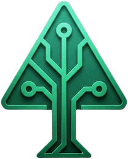
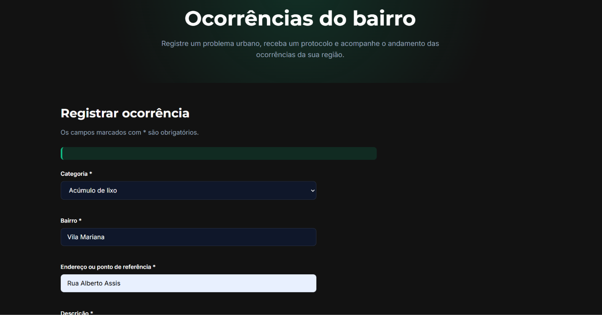
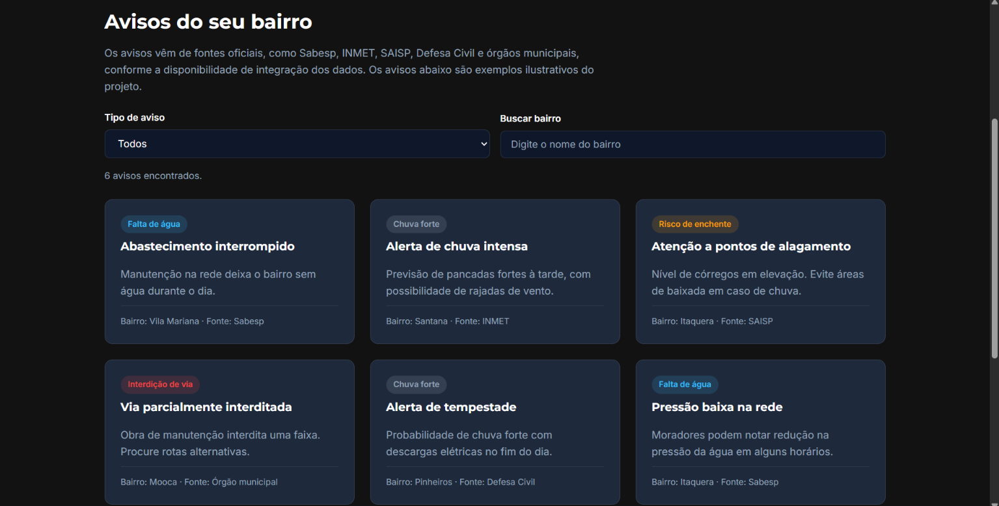

<p align="center">
  
</p>

<h1 align="center">BairroTech</h1>

<p align="center"><em>Tecnologia com o cidadão.</em></p>

Projeto desenvolvido para a **Global Solution 2026/2 – CitizenTech**, da **FIAP**, na disciplina de Front-End Design Engineering.

## Descrição

### O problema

Moradores de bairros e comunidades enfrentam, todos os dias, problemas de infraestrutura urbana, como buracos nas ruas, acúmulo de lixo, bueiros entupidos e postes apagados, além de situações que afetam a região, como falta de água, chuvas fortes, risco de enchentes e interdições de vias.

Muitas vezes é difícil comunicar esses problemas aos órgãos responsáveis e acompanhar o andamento das solicitações. As informações importantes também ficam espalhadas em vários canais, o que dificulta o acesso rápido a avisos confiáveis sobre o próprio bairro.

### A solução

O **BairroTech** é uma plataforma web que reúne, em um só lugar:

- **Registro de ocorrências** com categoria, bairro, endereço, descrição e fotografia opcional. Cada registro gera um protocolo para acompanhamento.
- **Priorização** das ocorrências, considerando o risco da categoria, a quantidade de relatos semelhantes e o tempo desde o primeiro registro.
- **Avisos comunitários** de falta de água, chuvas fortes, risco de enchentes e interdições de vias, com busca por bairro e filtro por tipo.
- **Assistente virtual** para orientar o morador e ajudar nas consultas.

> Os avisos exibidos no site são **exemplos ilustrativos**. A integração com fontes oficiais (Sabesp, INMET, SAISP, Defesa Civil e órgãos municipais) depende da disponibilidade dos dados.

### Objetivo

Promover uma comunidade mais informada, participativa e consciente, usando a tecnologia para facilitar a comunicação de problemas urbanos e ampliar o acesso a informações oficiais. O projeto está alinhado ao **ODS 11 – Cidades e Comunidades Sustentáveis**.

## Páginas do site

| Página | Arquivo | O que tem |
|---|---|---|
| Home | `index.html` | Apresentação, como o BairroTech ajuda e chamada para ação |
| Sobre | `sobre.html` | Problema, solução e objetivo |
| Ocorrências | `ocorrencias.html` | Formulário de registro, protocolo, lista e filtro por categoria |
| Avisos | `avisos.html` | Busca por bairro e filtro por tipo de aviso |
| Dúvidas | `faq.html` | Perguntas frequentes em acordeão |
| Integrantes | `integrantes.html` | Perfis da equipe |
| Contato | `contato.html` | Formulário de contato com validação |

## Tecnologias utilizadas

- **HTML5**, com elementos semânticos (`header`, `nav`, `main`, `section`, `article`, `footer`)
- **CSS3**, com variáveis, Flexbox, Grid e media queries (layout responsivo)
- **JavaScript** puro, sem frameworks ou bibliotecas
- **Google Fonts**: Montserrat e Inter
- **Git e GitHub** para versionamento

## Estrutura de pastas

```text
BairroTech/
├── assets/
│   ├── icons/          # ícones SVG (pin, acompanha, alerta)
│   └── images/         # logo e imagens do projeto
├── css/
│   ├── style.css       # variáveis, reset, layout, cabeçalho, menu, rodapé e seções
│   └── componentes.css # botões, cards, formulários, acordeão, listas e filtros
├── js/
│   ├── menu.js         # menu hambúrguer
│   ├── ocorrencias.js  # registro, protocolo e lista de ocorrências
│   ├── avisos.js       # busca e filtro dos avisos
│   ├── faq.js          # acordeão do FAQ
│   ├── formulario.js   # validação do formulário de contato
│   └── webchat.js      # assistente virtual
├── index.html
├── sobre.html
├── ocorrencias.html
├── avisos.html
├── faq.html
├── integrantes.html
├── contato.html
└── README.md
```

## Como executar

O projeto é estático e não precisa de instalação. Baixe ou clone o repositório e abra o arquivo `index.html` no navegador.

```bash
git clone [https://github.com/AnaFeitoza1/BairroTech.git]
```

## Imagens do projeto







## Autores

| Nome completo | RM | Turma | GitHub | LinkedIn |
|---|---|---|---|---|
| Ana Luiza Feitoza | 574706 | 1TDSPB | [GITHUB](https://github.com/AnaFeitoza1) | [LINKEDIN](https://www.linkedin.com/in/ana-feitoza-3460252b3) |
| Bruna Stagliano | 574714 | 1TDSPB | [GITHUB](https://github.com/brunastagliano) | [LINKEDIN](https://www.linkedin.com/in/bruna-stagliano-b602ab3b3/) |
| Bruno Ardenghi | 575828 | 1TDSPB | [GITHUB](https://github.com/brunoardenghi) | [LINKEDIN](https://www.linkedin.com/in/bruno-ferreira-3714b23b8/) |
| Rafael Cadena | 576861 | 1TDSPB | [GITHUB](https://github.com/rafaelcadena-tech) | [LINKEDIN](https://www.linkedin.com/in/rafael-cadena-22b253440/) |
| Yohan Martins | 574953 | 1TDSPB | [GITHUB](https://github.com/ymasotti-boop) | [LINKEDIN](https://www.linkedin.com/in/yohan-martins-020183255/) |

## Repositório

[https://github.com/AnaFeitoza1/BairroTech]

## Contato

Equipe BairroTech: [bairrotech@gmail.com]

## Uso de IA generativa

Foi usada a ferramenta **Claude (Anthropic)** como apoio ao desenvolvimento, para:

- atuar como mentor na estrutura das páginas, fornecendo versões iniciais e obrigatórias do código que a equipe leu, testou e adaptou ao decorrer do projeto;
- revisar o código, apontando erros e melhorias (acessibilidade, organização e nomes de classes);
- orientar o uso de Git e a organização do repositório.

Todo o conteúdo criado foi lido, testado, adaptado e revisado pela equipe, que se responsabiliza pelo código entregue.